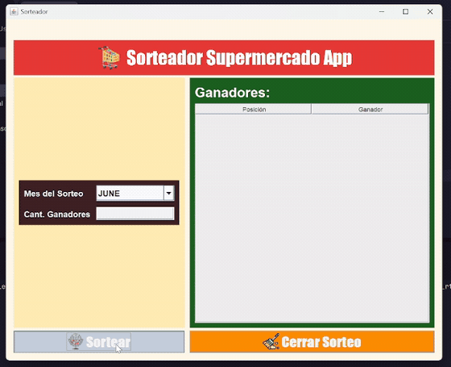
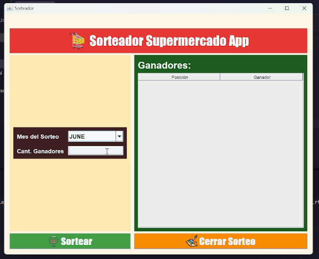
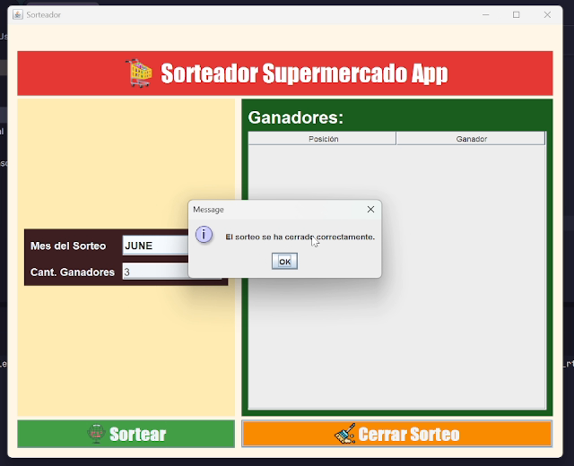

# Sorteo en Java

Proyecto final del curso de Java de **TodoCode**.

## Descripción

Aplicación de escritorio desarrollada en Java Swing como ejercicio práctico para aplicar los conocimientos adquiridos durante el curso.

El proyecto parte de la propuesta trabajada en el curso, pero cuenta con una implementación propia, en la que tomé decisiones diferentes a las mostradas por la profesora para resolver el problema y organizar el código según mi propio criterio.

## Objetivo

Practicar Java mediante el desarrollo de una aplicación funcional, reforzando los fundamentos del lenguaje, la programación orientada a objetos, la gestión de eventos y la implementación de reglas de negocio.

## Características

- Interfaz gráfica desarrollada con Java Swing.
- Gestión de la lógica del sorteo.
- Aplicación de validaciones y restricciones del proceso.
- Manejo de datos durante la ejecución del programa.

## Persistencia

El proyecto no implementa persistencia de datos. La información se mantiene en memoria durante la ejecución y no se almacena en una base de datos ni se conserva automáticamente al cerrar la aplicación.

Esta decisión es coherente con el propósito académico del proyecto: practicar Java y aplicar sus fundamentos sin incorporar infraestructura adicional que no forma parte de los objetivos del ejercicio.

## Contexto académico

Este proyecto fue realizado como trabajo final del curso de Java de TodoCode. La implementación refleja mi propia manera de abordar el ejercicio y aplicar los conocimientos adquiridos, tomando la propuesta del curso como punto de partida.

## Tecnologías

- Java
- Java Swing

## Alcance

Se trata de un proyecto educativo, no de un sistema de sorteos destinado a producción. Su finalidad principal es el aprendizaje y la práctica de programación en Java.

## Demostración

La siguiente animación muestra el funcionamiento de la aplicación, desde la interfaz inicial hasta el cierre del sorteo.

  

## Capturas de pantalla

### Interfaz inicial

  

### Sorteo cerrado

  

